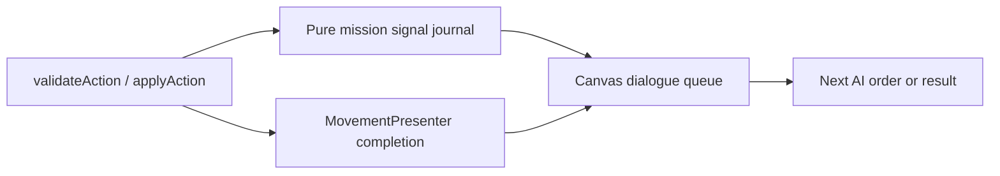

# Architecture

## Dependency boundaries

`src/core` owns game rules and state. `src/ai` owns decisions and simulations. `src/game` owns Phaser scenes, rendering, Canvas UI, input, cameras, animation, sound, and effects.

Allowed dependencies are `game -> core`, `game -> ai`, and `ai -> core`. Neither `core` nor `ai` may import Phaser or anything from `game`.

```text
Phaser Canvas input
  -> BattleInputController creates GameAction
  -> validateAction(state, action)
  -> applyAction(state, action)
  -> next GameState and action events
  -> BattleScene.renderGameState(previousState, nextState)
```

The AI submits the same `GameAction` values through the same validation and application functions. No caller may edit match state directly.

## Core contracts

```ts
interface GameState {
  scenarioId: string;
  turn: number;
  activeSide: SideId;
  units: Record<string, UnitState>;
  controlPoints: Record<string, ControlPointState>;
  scores: { blue: number; red: number };
  winner: SideId | null;
}

type GameAction = MoveAction | AttackAction | CaptureAction | WaitAction | EndTurnAction;

function validateAction(state: GameState, action: GameAction): ValidationResult;
function applyAction(state: GameState, action: GameAction): ApplyActionResult;

interface ApplyActionResult {
  accepted: boolean;
  state: GameState;
  events: GameEvent[];
}
```

`ValidationResult` is a discriminated valid/invalid result with a stable reason code. `applyAction` returns a new state and ordered domain events for accepted actions; rejected actions return the exact input state with no events. It must not depend on time, random global state, or Phaser objects.

Team scores are deterministic core state. An attack awards the attacking side the HP actually removed after defence modifiers; a successful capture awards 5 points. `team-scored` follows the corresponding combat or capture event. The HUD only renders these values; it never calculates or mutates them.

When `EndTurnAction` activates a side, the core first refreshes that side's units and then restores 2 HP (capped at `maxHealth`) to each damaged unit on a control point it owns. It emits deterministic `unit-healed` events in unit-ID order before `turn-ended`; this passive effect does not alter score or action availability.

Agents receive a state snapshot and return an action candidate:

```ts
interface Agent {
  readonly id: string;
  chooseAction(state: GameState, context: AgentContext): Promise<GameAction>;
}

interface AgentContext {
  actionsThisTurn: readonly GameAction[];
}
```

Randomness is injected through a seeded source stored in scenario or simulation configuration. A replay records scenario identity, seed, and accepted actions; replaying them must reproduce the final state.

Completed Canvas matches additionally create a versioned `RecordedMatch` in the presentation layer. It snapshots `MapDefinition`, `MatchConfiguration`, result metadata, and the core replay actions. `ReplayTimeline` remains pure core logic: it reapplies every accepted action with `applyAction` to produce immutable state/event frames. The replay viewer never runs agents or calls LM Studio.

`LmStudioAgent` remains under `src/ai` and depends only on core state/actions plus an injected HTTP
client. It sends a current state snapshot, legal action IDs, and current-turn history to LM Studio's
OpenAI-compatible API. Its response is mapped only to the offered action set, then still validated by
the shared action path. Network, JSON, timeout, and legality failures use `HeuristicAgent` for that
single decision. Remote inference is not deterministic; deterministic replays record its accepted
actions and do not issue HTTP requests.

The browser stores one local LM Studio endpoint, an optional request timeout, and independent Blue/Red
model IDs. Before a match, the menu copies them into side-specific connections in `MatchConfiguration`;
`BattleScene` uses only that snapshot. Therefore a running match and `PLAY AGAIN` retain their
competitors and timeout even if global settings are later changed.

Display models cross into Phaser as plain data only:

```ts
interface SelectedUnitViewModel {
  name: string;
  health: number;
  maxHealth: number;
  movementPoints: number;
  attackRange: string;
  hasActed: boolean;
}
```

## Phaser structure

- `BootScene` loads manifest-defined assets, fonts, audio, and temporary diagnostic textures, then opens the menu.
- `MainMenuScene` renders the title, scenario and AI selection, and the start button in Canvas.
- `BattleScene` owns `GameState`, selected unit ID, legal action previews, input lock, world rendering, Canvas HUD, and action animation.
- `ResultScene` renders match outcome, turn count, summary statistics, replay, and menu controls in Canvas.

`BattleScene` keeps separate `worldContainer` and `hudContainer` containers. World objects move with the map camera. HUD objects call `setScrollFactor(0)` and do not move or zoom with the board. The first version uses one bounded world camera; a separate UI camera is allowed only if needed later.

`renderGameState(previousState, nextState)` incrementally reconciles unit views by ID, terrain/control-point views, HUD data, event log entries, and legal-action indicators. It must not recreate the entire scene after each action.

## User map library

`MapDefinition` is a serializable core value object. It contains board dimensions, sparse terrain placements, unit placements, and control-point placements; grass is implicit. `createGameStateFromMap` deterministically creates runtime unit identifiers, stats, and terrain-aware board state. Browser-local persistence, the Canvas editor, and file import/export live under `src/game/maps` and must not be imported by `core` or `ai`.

Map files use a versioned JSON schema. Schema-v1 maps are migrated deterministically to schema v2 with an empty terrain list. A map can be saved as a draft, but a match may begin only when both sides have at least one unit. The only DOM exception is a short-lived native file picker/download link initiated by a Canvas button for JSON import/export; it is not part of the game interface.

## Headless simulation

`src/ai/simulation` runs sequential graphics-free batches. It accepts only core `GameState` factories,
AI agents, maps, and seeds; it must not import Phaser or `src/game`. Each match is constructed from
either the built-in skirmish factory or a validated `MapDefinition` loaded by the CLI. Random agents
receive a reproducible derived seed (`baseSeed + matchIndex`); Heuristic agents are deterministic.

LM Studio may be used in a batch, but remote decisions are non-deterministic. The shared AI decision
helper validates each offered action and falls back to `HeuristicAgent` on request, parsing, timeout,
or legality failure. JSONL records store accepted actions and metadata, so replaying them never invokes
LM Studio. Each record also stores final team scores and an action-level reward trail containing the
action, domain events, and Blue/Red score delta. A match that reaches the configured action limit is
recorded as incomplete.

CLI settings resolve in this order: explicit arguments, `.env.local`, tracked `.env`, then code
defaults. `.env.local` is local-only and ignored by Git; `.env` must contain only safe defaults.

## Canvas UI contracts

`Button` supports normal, hover, pressed, and disabled states; pointer handling; label changes; and destruction. `Panel` supports background, border, title, padding, children, resize, visibility, and destruction. `ProgressBar` represents bounded numeric progress. `ScrollableList` is a bounded event log showing the last 6–10 events in v1; full scrolling is out of scope.

All UI values come from one `UiTheme`. UI components never hold or mutate core entities: they receive view data and emit callbacks that create actions.

## Testing boundary

Use Vitest for unit tests and follow TDD: write a failing behavior-level test, implement the minimum code needed to pass it, then refactor with the suite green. Core and AI tests run without Phaser. Phaser tests focus on input-to-action wiring and presentation contracts, while rules correctness remains covered at the core boundary.

## Campaign boundaries

src/core/campaigns owns pure versioned definitions, validation with injected maps, draft transformations, mission state factories and deterministic narrative signals. Only victory policy enters GameState. Browser storage, text controls and narrative presentation stay in src/game; selection never becomes a GameAction.

Both human and AI acceptance paths feed the same mission signal adapter. Core acceptance journals occurrences immediately; `MovementPresenter` completion opens the queued Canvas dialogue. Orders and AI remain blocked until dialogue completion chooses the next order or terminal result. Pause is combined with dialogue blocking, and exit/disposal invalidates pending decisions and callbacks. `ReplayDialogue` consumes snapshotted occurrences independently of live campaign matching or progression.


