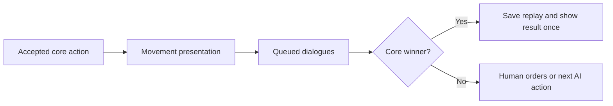

# Campaigns

Campaign schema v2 contains `schemaVersion`, `id`, `name`, and an ordered `missions` array. Missions contain stable `id`, `name`, `builtInMapId`, `conditions`, and ordered dialogue `events`. Empty missions or lines are supported drafts; Play requires readiness. Built-in maps are injected into pure validation.

Conditions are `{ "type": "standard-match" }` or `{ "type": "standard-match-or-reach-cell", "unit": { "type": "any" }, "cell": { "x": 11, "y": 2 }, "mapBinding": "tutorial-movement-12x5" }`. Specific selectors use `{ "type": "specific", "unitId": "blue-infantry-1" }`. Only eligible Blue units can win by ending an accepted move on the goal. Crossing, selection, initial occupancy, and rejected moves do not count. Standard defeat and combat victory still apply. Terrain routes ignore temporary occupancy and single-turn movement allowances when validating objectives.

Dialogue events contain `id`, `type: "dialogue"`, a trigger, and `lines` with speaker/text. Six triggers are mission-start, mission-end, turn (positive `number`), unit-selected, unit-moved, and unit-arrived (exact `cell`). Unit triggers contain a selector and explicit `mapBinding`. Changing maps invalidates these bindings even if runtime unit IDs coincide; authors must explicitly confirm references. Reordering preserves identities and content.

Each event fires once per attempt, in authored order for each signal. Startup processes mission-start then turn one. The displayed turn increments at each side change. Movement and arrival are matched together, followed by mission-end on a final action. Selection is a human presentation change, never a combat order. Reclicking, deselection, blocked input, and AI selection do not qualify. Reading dialogues cannot change combat state, actions, scores, or results.

`src/core/campaigns` owns serializable definitions, readiness, draft transformations, core mission initialization, and deterministic matching. Browser storage and Phaser presentation belong to `src/game/campaigns` and Canvas scenes.

## Authoring

Open CAMPAIGNS from the menu. CREATE starts a local draft; OPEN / RENAME opens the selected definition. Built-in campaigns are discovered automatically from `src/core/campaigns/definitions/*.json`, validated structurally, sorted by ID, and returned as independent definitions. The shipped tutorial is `tutorial.json`; the library does not depend on browser storage to discover it. Invalid source files and duplicate source IDs report errors containing the source filename.

SAVE always writes to the browser library at `ai-war-game.campaigns.v1`. Saving a built-in draft creates a separate local campaign ID without colliding with either catalog, preserves its name and mission/dialogue content, and continues editing that copy. Later SAVE operations update the same local entry. SAVE AS COPY is replaced by SAVE. SAVE AND LEAVE also saves locally, including when leaving a built-in draft, and navigates only after success with no newer unsaved edits.

In DEV, OPEN / RENAME also opens built-ins. BUILT IN SAVE is available for built-in, new and local drafts: it writes `src/core/campaigns/definitions/<id>.json` through the development server and refreshes the catalog. It preserves the current ID, updating that source file if present or creating it otherwise, and does not alter local storage. After local SAVE creates a copy with a new ID, BUILT IN SAVE targets that copy's ID rather than the original. IDs must contain lowercase letters, digits and single hyphen separators. Writing uses a temporary sibling file and replacement; failures retain the original source and dirty draft. A local entry saved to source remains separately editable even if its ID also exists in the built-in catalog. Both save paths mark only their submitted snapshot as saved, preserving edits made during pending saves.

In production, built-ins remain playable and exportable, but OPEN / RENAME is disabled and direct editor entry is rejected. The source-write API is absent. Local campaigns remain editable in both modes; DELETE applies only to local entries. Campaign names and mission names are edited through their Canvas buttons. Add missions, select a built-in map using the map arrows, choose standard victory or standard plus reach cell, then use the preview to select a goal and optionally a specific Blue unit. CONFIRM MAP BINDINGS explicitly confirms transferred references after a map change.

EDIT DIALOGUE EVENTS opens the event list. Add an event, cycle TRIGGER through the six forms, configure the turn, unit, or cell, then add lines. SPEAKER and EDIT TEXT open Canvas text controls. Arrows, Home, End, Backspace, and Delete edit at the cursor; Enter inserts a line break in dialogue text. Ctrl+V pastes through the native clipboard API. SCROLL UP/DOWN keeps long text readable. Names are limited to 120 Unicode code points and dialogue text to 12,000; over-limit insertions show an error without dropping existing text. Mission/event lists have independent list scrolling and MOVE UP/DOWN controls; line arrows select a line and LINE UP/DOWN reorder it. SAVE retains incomplete drafts; readiness errors identify affected fields and ERRORS UP/DOWN show additional errors. BACK on a dirty or new draft offers SAVE AND LEAVE, DISCARD AND LEAVE, and CANCEL.

## File exchange

Library IMPORT and EXPORT are available in DEV and production. EXPORT downloads one schema-v2 `CampaignDefinition` as `<name>.ai-war-campaign.json`: `schemaVersion`, `id`, `name`, and ordered `missions`. It excludes the browser-library envelope, playthrough progress and replay data. Editor EXPORT downloads the current draft, including unsaved changes, without saving it or clearing its dirty state.

IMPORT always creates local content. If the incoming campaign ID exists in either catalog, the library tries `-2`, `-3`, and subsequent suffixes without overwriting existing entries. Mission/event IDs, ordering, bindings, speaker names and Unicode/multiline dialogue remain intact. The imported campaign is selected and scrolled into view. Structurally valid incomplete drafts and missing-map references can be imported; readiness errors keep Play disabled until corrected. Malformed JSON, unsupported versions, invalid structures, read failures and storage failures show an error and preserve existing data.

Canvas buttons initiate temporary hidden native file pickers or download links. Selection, cancellation, failures and scene shutdown remove pickers and handlers; download links and object URLs are cleaned up even on failure. Imports completed after leaving the scene are ignored.

## Playing

PLAY snapshots the complete campaign, all resolved maps, policies, and participants. Blue is human; Red is Heuristic. Progress exists only for the current session. A won mission offers NEXT MISSION, a defeat offers RETRY, and the last victory announces CAMPAIGN COMPLETE. Every launch/retry has fresh units, movement, health, scores, actions, and one-shot events. Nothing carries between missions. Later library edits do not change the active run.

On maps without Red, END TURN accepts Blue's end-turn and then automatically submits an ordinary Red end-turn after presentation and dialogue barriers. The counter advances twice and core rules restore Blue movement. Both actions are recorded. An unfinished manual exit never fires mission-end or advances progress.

Dialogues show speaker, line number, wrapped text, NEXT / CLOSE, and scroll controls. Battle orders, camera keyboard input, and AI wait while dialogue is queued/open. Escape opens pause; resuming retains the current line. Exiting cancels the queue and stale continuations. Action order is:

## First tutorial mission

The built-in Tutorial Campaign contains the implemented Selection and Movement mission. Its 12×5 map has Blue infantry at `(0,1)` and `(0,3)`, no opponents, terrain obstacles, or control points. The goal `(11,2)` is highlighted and shown in the HUD. Either unit works. Close the introduction, click a Blue unit, close the movement instruction, then click a highlighted destination. The first move explains movement points and END TURN. Continue moving and renew movement as needed; arriving at the goal opens congratulations before the completion result. An example route for either infantry is `(4,2)`, END TURN, `(8,2)`, END TURN, `(11,2)`; reselect after each turn. WASD/arrows pan, mouse wheel zooms. No combat/capture or future placeholder missions are part of this lesson.

## Replay format and seeking

The writer emits RecordedMatch v3. Its `victoryPolicy` is serializable; campaign records also contain `narrative` with campaign identity/name, mission snapshot, and occurrences `{ eventId, sequence, afterActionCount, signal }`. The reader accepts v1 with standard policy and no narrative, v2 with or without narrative, and v3 with a narrative language ID when narrative is present. Maps, participants, actions, policies, and dialogue definitions are snapshots. Core replay frames reproduce outcomes without AI/network calls or campaign progression. Invalid policy, mission references, journal order/boundaries, duplicates, impossible selection, and mismatched action/end signals reject the record.

Boundary zero dialogues precede the first action; boundary N dialogues follow action N's animation. Forward step/autoplay waits for every line. START, backward steps, and nonadjacent seeking cancel current dialogue/movement and immediately render the target frame without opening its dialogue. The modal provides REPLAY START and PREVIOUS FRAME while a dialogue is open. A subsequent forward traversal can show that boundary's occurrences again. Playback uses recorded selection facts and never invents live selection signals.

## Dialogue languages and compatibility

New campaign files use schema v2. Each English dialogue line has a stable event-local `id`, `speaker` and `text`. An event can embed `localizations: { "ru": { "line-1": { "speaker": "Командир", "text": "Привет" } } }`. Speaker and text may be omitted or whitespace-only independently; each falls back to its English source. References to absent lines, duplicate line IDs and nonstring translation fields are rejected. v1 imports are normalized deterministically to English-only v2 with line IDs derived from original positions. Reading legacy browser storage does not rewrite it; explicit save/export writes v2.

In EDIT DIALOGUE EVENTS, LANGUAGE opens the dialogue language list. English is initially selected. ADD links an installed game language by stable ID. In a translated language, edit speaker/text for existing lines; English-only line/event structure controls are disabled. VIEW ENGLISH SOURCE opens the complete source in a scrolling Canvas dialog. Blank fields show English fallback. Reordering English lines preserves translations; deleting a line removes its translation entries; new lines begin untranslated. English edits retain translations for manual review. Unknown imported language IDs stay editable with an unavailable-pack warning. Renaming a game language updates its displayed name while preserving the ID and links. Local SAVE, DEV BUILT IN SAVE, copying and portable export retain all dictionaries.

At launch the run snapshots the campaign, translations and selected narrative language. Retry and next mission keep that snapshot. RecordedMatch v3 stores `narrative.localeId` and the complete translated mission snapshot. Dialogue uses the recorded language even after source edits or language-pack removal; replay controls use the viewer's current interface language. v1 action-only and v2 English narrative records remain readable; legacy dialogue defaults to English. Replays reconstruct accepted actions and never call AI or network inference. Keep compatible readers or exported backups when rolling back code after saving newer formats.