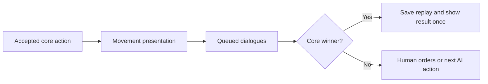

# Campaigns

Campaign schema v1 contains `schemaVersion`, `id`, `name`, and an ordered `missions` array. Missions contain stable `id`, `name`, `builtInMapId`, `conditions`, and ordered dialogue `events`. Empty missions or lines are supported drafts; Play requires readiness. Built-in maps are injected into pure validation.

Conditions are `{ "type": "standard-match" }` or `{ "type": "standard-match-or-reach-cell", "unit": { "type": "any" }, "cell": { "x": 11, "y": 2 }, "mapBinding": "tutorial-movement-12x5" }`. Specific selectors use `{ "type": "specific", "unitId": "blue-infantry-1" }`. Only eligible Blue units can win by ending an accepted move on the goal. Crossing, selection, initial occupancy, and rejected moves do not count. Standard defeat and combat victory still apply. Terrain routes ignore temporary occupancy and single-turn movement allowances when validating objectives.

Dialogue events contain `id`, `type: "dialogue"`, a trigger, and `lines` with speaker/text. Six triggers are mission-start, mission-end, turn (positive `number`), unit-selected, unit-moved, and unit-arrived (exact `cell`). Unit triggers contain a selector and explicit `mapBinding`. Changing maps invalidates these bindings even if runtime unit IDs coincide; authors must explicitly confirm references. Reordering preserves identities and content.

Each event fires once per attempt, in authored order for each signal. Startup processes mission-start then turn one. The displayed turn increments at each side change. Movement and arrival are matched together, followed by mission-end on a final action. Selection is a human presentation change, never a combat order. Reclicking, deselection, blocked input, and AI selection do not qualify. Reading dialogues cannot change combat state, actions, scores, or results.

`src/core/campaigns` owns serializable definitions, readiness, draft transformations, core mission initialization, and deterministic matching. Browser storage and Phaser presentation belong to `src/game/campaigns` and Canvas scenes.

## Authoring

Open CAMPAIGNS from the menu. CREATE starts a local draft; OPEN / RENAME opens the selected definition. Opening a built-in campaign and saving uses SAVE AS COPY with a new identity; the original remains available even if local storage fails. DELETE applies to local entries. Campaign names and mission names are edited through their Canvas buttons. Add missions, select a built-in map using the map arrows, choose standard victory or standard plus reach cell, then use the preview to select a goal and optionally a specific Blue unit. CONFIRM MAP BINDINGS explicitly confirms transferred references after a map change.

EDIT DIALOGUE EVENTS opens the event list. Add an event, cycle TRIGGER through the six forms, configure the turn, unit, or cell, then add lines. SPEAKER and EDIT TEXT open Canvas text controls. Arrows, Home, End, Backspace, and Delete edit at the cursor; Enter inserts a line break in dialogue text. Ctrl+V pastes through the native clipboard API. SCROLL UP/DOWN keeps long text readable. Names are limited to 120 Unicode code points and dialogue text to 12,000; over-limit insertions show an error without dropping existing text. Mission/event lists have independent list scrolling and MOVE UP/DOWN controls; line arrows select a line and LINE UP/DOWN reorder it. SAVE retains incomplete drafts; readiness errors identify affected fields and ERRORS UP/DOWN show additional errors. BACK on a dirty or new draft offers SAVE AND LEAVE, DISCARD AND LEAVE, and CANCEL.

## Playing

PLAY snapshots the complete campaign, all resolved maps, policies, and participants. Blue is human; Red is Heuristic. Progress exists only for the current session. A won mission offers NEXT MISSION, a defeat offers RETRY, and the last victory announces CAMPAIGN COMPLETE. Every launch/retry has fresh units, movement, health, scores, actions, and one-shot events. Nothing carries between missions. Later library edits do not change the active run.

On maps without Red, END TURN accepts Blue's end-turn and then automatically submits an ordinary Red end-turn after presentation and dialogue barriers. The counter advances twice and core rules restore Blue movement. Both actions are recorded. An unfinished manual exit never fires mission-end or advances progress.

Dialogues show speaker, line number, wrapped text, NEXT / CLOSE, and scroll controls. Battle orders, camera keyboard input, and AI wait while dialogue is queued/open. Escape opens pause; resuming retains the current line. Exiting cancels the queue and stale continuations. Action order is:

## First tutorial mission

The built-in Tutorial Campaign contains the implemented Selection and Movement mission. Its 12×5 map has Blue infantry at `(0,1)` and `(0,3)`, no opponents, terrain obstacles, or control points. The goal `(11,2)` is highlighted and shown in the HUD. Either unit works. Close the introduction, click a Blue unit, close the movement instruction, then click a highlighted destination. The first move explains movement points and END TURN. Continue moving and renew movement as needed; arriving at the goal opens congratulations before the completion result. An example route for either infantry is `(4,2)`, END TURN, `(8,2)`, END TURN, `(11,2)`; reselect after each turn. WASD/arrows pan, mouse wheel zooms. No combat/capture or future placeholder missions are part of this lesson.

## Replay format and seeking

The writer emits RecordedMatch v2. Its `victoryPolicy` is serializable; campaign records also contain `narrative` with campaign identity/name, mission snapshot, and occurrences `{ eventId, sequence, afterActionCount, signal }`. The reader accepts v1 with standard policy and no narrative, and v2 with or without narrative. Maps, participants, actions, policies, and dialogue definitions are snapshots. Core replay frames reproduce outcomes without AI/network calls or campaign progression. Invalid policy, mission references, journal order/boundaries, duplicates, impossible selection, and mismatched action/end signals reject the record.

Boundary zero dialogues precede the first action; boundary N dialogues follow action N's animation. Forward step/autoplay waits for every line. START, backward steps, and nonadjacent seeking cancel current dialogue/movement and immediately render the target frame without opening its dialogue. The modal provides REPLAY START and PREVIOUS FRAME while a dialogue is open. A subsequent forward traversal can show that boundary's occurrences again. Playback uses recorded selection facts and never invents live selection signals.
